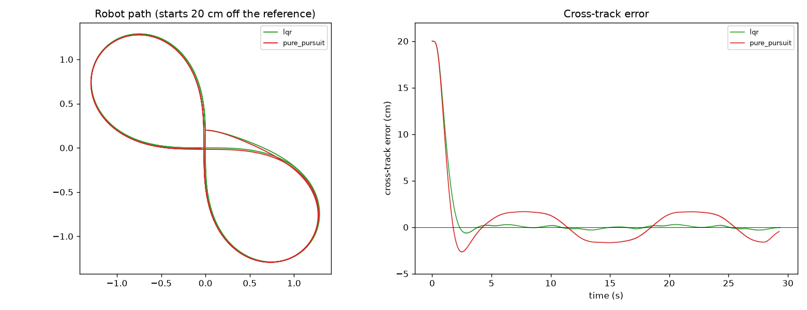

# ROS 2 C++ Path Tracker: Pure Pursuit and LQR for Differential-Drive Robots


A ROS 2 (Humble) package in C++17 that makes a wheeled robot follow a path. It runs fully in simulation on any laptop through Docker, and the same nodes drive a real ROS 2 robot (TurtleBot 4, ROSMASTER X3 or any base that publishes `/odom` and takes `/cmd_vel`).



## What's inside

| Node | Does |
|---|---|
| `path_publisher_node` | Publishes a figure-8 or rounded-loop `nav_msgs/Path` on `/plan` (transient-local QoS). On a real robot it places the path where the robot is standing. |
| `tracker_node` | Follows `/plan` using `/odom`, publishes `/cmd_vel` at 50 Hz. Pure Pursuit or LQR with curvature feed-forward, a speed limit in tight turns, slow-down at the goal, and a stop if odometry goes quiet. Publishes `/tracking_error` and logs a CSV. |
| `sim_robot_node` | Stand-in robot for testing without Gazebo: differential-drive model with velocity lag, acceleration and turn-rate limits, optional odometry noise, `/odom`, `/ground_truth` and TF. |

- **ROS-independent core:** the controllers live in header-only C++ (`include/path_tracker/`), so the same `TrackerCore` class runs inside the ROS node, the benchmark and the unit tests.
- **Tests:** 11 GoogleTest cases (curvature, cross-track sign, smooth projection, LQR closed-loop stability at every speed, convergence, angular limit, goal stop, deterministic noise) run by `colcon test`.
- **CI:** GitHub Actions builds the Docker image (colcon build + tests), runs the full ROS 2 simulation with both controllers, and fails if RMS tracking error goes above 3 cm.

## Results

### C++ benchmark (`bench`, same controller code, no ROS)

Robot: |w| ≤ 2 rad/s, 0.15 s velocity lag, 50 Hz control, starts 20 cm off the path. Figure-8: 8.4 m per lap, 2 laps. Errors scored after the first 3 s.

<!--  -->

```text
Robot: diff-drive, |w| <= 2 rad/s, 0.15 s velocity lag; control at 50 Hz; starts 0.2 m off the path
Figure-8: 8.4 m per lap (max curvature 1.87 1/m), 2 laps. Loop: 8.1 m per lap, 2 laps.

scenario                        controller            settle   RMS CTE   max CTE  w rate   lap time
figure-8, 0.3 m/s               Pure Pursuit          2.34 s    0.7 cm    1.7 cm   0.10     57.8 s
figure-8, 0.3 m/s               LQR + feed-forward    2.82 s    0.2 cm    2.4 cm   0.10     57.9 s

figure-8, 0.6 m/s               Pure Pursuit          1.46 s    1.3 cm    2.1 cm   0.34     29.3 s
figure-8, 0.6 m/s               LQR + feed-forward    1.72 s    0.1 cm    0.6 cm   0.33     29.4 s

loop, 0.6 m/s                   Pure Pursuit          1.64 s    2.4 cm    4.2 cm   0.50     29.0 s
loop, 0.6 m/s                   LQR + feed-forward    1.88 s    0.6 cm    1.4 cm   0.76     29.3 s

figure-8, 0.6 m/s, noisy odom   Pure Pursuit          1.48 s    1.3 cm    2.1 cm   3.00     29.2 s
figure-8, 0.6 m/s, noisy odom   LQR + feed-forward    1.72 s    0.2 cm    0.4 cm   2.71     29.4 s

settle = time to get within 3 cm of the path; errors are scored after the first 3 s
w rate = mean |change in commanded angular velocity|, rad/s^2 (lower = smoother); lap time = both laps
```

### ROS 2 simulation (all three nodes, in Docker)

```
log                               duration   settle   RMS CTE   max CTE  w rate
results/lqr.csv                     29.4 s   1.74 s    0.2 cm    0.6 cm    0.33
results/pure_pursuit.csv            29.3 s   1.50 s    1.3 cm    2.1 cm    0.31
```

### Real robot

Next step: run `robot.launch.py` on a ROSMASTER X3 at ASU.

## Run it

**Docker (any OS, includes ROS 2):**

```bash
docker build -t ros2-path-tracker .            # builds with colcon and runs the unit tests
mkdir -p results
docker run --rm -v "$PWD/results:/results" ros2-path-tracker controller:=lqr csv_path:=/results/lqr.csv
docker run --rm -v "$PWD/results:/results" ros2-path-tracker controller:=pure_pursuit csv_path:=/results/pure_pursuit.csv
python3 scripts/summarize.py results/lqr.csv results/pure_pursuit.csv
python3 plot.py results/lqr.csv results/pure_pursuit.csv
```

Launch arguments: `controller:=lqr|pure_pursuit`, `speed:=0.6`, `shape:=figure8|loop`, `odom_noise:=0.01`, `csv_path:=...`.

**Benchmark only, no ROS (macOS or Linux):**

```bash
cmake -S path_tracker -B build && cmake --build build && ./build/bench
```

**On a real robot** (after the robot's own bringup is running):

```bash
ros2 launch path_tracker robot.launch.py controller:=lqr speed:=0.25 shape:=loop csv_path:=run1.csv
```

## How the controllers work

- **Pure Pursuit:** steer along the arc through a point `0.5 v + 0.25` m ahead on the path: `w = 2 v sin(alpha) / d`.
- **LQR:** linearised error model `x = [cross-track e, heading error th]`, input `u = w - v kappa`, discrete Riccati equation solved per speed and cached. Final command `w = v kappa_ahead - K x`, where the feed-forward uses curvature 0.15 s ahead to cover the robot's lag.
- **Projection:** the robot is projected onto the path *segment*, not just the nearest sample, so errors change smoothly. Snapping to samples made LQR's steering jitter.

## Layout

```
path_tracker/                     ROS 2 package (ament_cmake)
  include/path_tracker/           header-only core: path, controllers, robot model, tracker, sim
  src/                            the three rclcpp nodes
  bench/bench.cpp                 closed-loop benchmark
  test/test_core.cpp              GoogleTest unit tests
  launch/sim.launch.py            simulation (ends by itself at the goal)
  launch/robot.launch.py          real robot
  config/params.yaml              every parameter, commented
scripts/run.sh                    Docker entry point
scripts/summarize.py              metrics from CSV logs (also used by CI)
plot.py                           tracking.png from CSV logs
```

## Limitations

- Kinematic robot model (no wheel slip); the simulated noise is position jitter, not odometry drift.
- Constant cruise speed with simple curvature and goal slow-down, not a full velocity planner.
- Paths are assumed to be in the odometry frame; with a map you would transform them (or use Nav2's controller server plugin interface).
